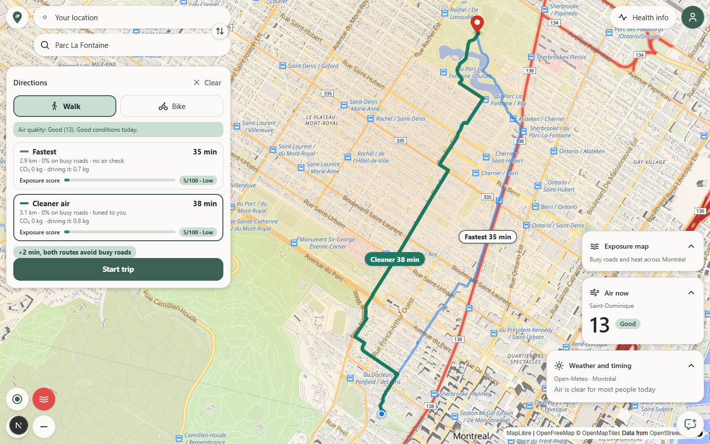

# 🍃 Clair

A web app that finds walking and biking routes in Montréal that keep you away from busy, polluted roads, tuned to your asthma, COPD and heat sensitivity.
Built with **Next.js**, **FastAPI** and **GraphHopper**, on open data from **Montréal's air quality network (RSQA)** and **Open-Meteo**, with an AI trip assistant powered by **Groq**.



---

## Inspiration

Navigation apps pick the fastest road, and the fastest road is often the busiest one.
Traffic pollution is strongest right beside busy streets, and for people with asthma, COPD or heat sensitivity, that can be the difference between a good trip and a bad day.
**Clair** was built with a simple goal: help people in Montréal walk and bike in cleaner air, without giving up much time.

## Features

- 🚶 **Two Routes, Side by Side:**
  The fastest route and a cleaner-air route, with distance, time on busy roads, and a one-line tradeoff such as "+3 min, quieter streets".
- 🫁 **Tuned to Your Health:**
  Rate your asthma, COPD and heat sensitivity, and on poor-air days the cleaner route avoids main roads even more strictly.
- 🌬️ **Live Air and Weather:**
  The air quality index from the nearest Montréal station, plus the feels-like temperature, wind and chance of rain.
- 🔥 **Exposure Map:**
  One tap shows the city's busy roads glowing red and a heat layer of the warmest neighbourhoods underneath.
- 💬 **AI Trip Assistant:**
  Describe your trip in one sentence, in English or French, and get routes and advice drawn from live conditions and public health guidance.
- 🌱 **CO₂ Saved:**
  Every trip shows the CO₂ you kept out of the air compared with driving, and your profile keeps a running total.

## How We Built It

- **Frontend:** Next.js and React with TypeScript, a MapLibre map on OpenFreeMap tiles, and a mobile-first interface.
- **Backend:** FastAPI serves routes, air quality and weather, and two small scripts download fresh air and weather data every hour.
- **Routing:** A self-hosted GraphHopper server on OpenStreetMap data, with custom rules that push the cleaner route away from motorways, trunk and primary roads.
- **AI Assistant:** An open model on Groq reads the trip from a sentence, and its answers draw on 23 health guidance notes from Health Canada, the Gouvernement du Québec and the Ville de Montréal.

## Tech Stack

- Next.js 16 + React 19 + TypeScript
- MapLibre GL JS + OpenFreeMap
- Python + FastAPI
- GraphHopper 10 + OpenStreetMap
- SQLite + JSON exports
- RSQA open data (Ville de Montréal), Open-Meteo, Environment Canada
- Groq API

---

## ⚙ How to Run Locally

1. **Clone the Repository**

   ```bash
   git clone https://github.com/jeromekithinji/cleanAir.git
   cd cleanAir
   ```

2. **Install Dependencies**

   Install the web app's packages, then create a Python environment for the backend:

   ```bash
   npm install
   python -m venv .venv
   ```

   Activate it (`.venv\Scripts\Activate.ps1` on Windows PowerShell, `source .venv/bin/activate` on macOS and Linux), then:

   ```bash
   pip install -r backend/requirements.txt
   ```

   *(`npm install` copies the MapLibre worker into `public/` with `cp`. On Windows, run it from Git Bash, or copy `node_modules/maplibre-gl/dist/maplibre-gl-worker.mjs` into `public/` yourself.)*

3. **Set Up Environment Variables**

   Create a `.env` file in the root folder for the AI assistant:

   ```env
   GROQ_API_KEY=your_groq_api_key
   GROQ_MODEL=openai/gpt-oss-120b
   ```

   Then copy the backend settings. The defaults work as they are:

   ```bash
   cp backend/.env.example backend/.env
   ```

   *(The map, routes, air and weather work without a Groq key. Only the assistant needs it.)*

4. **Start GraphHopper**

   You need Java 17 or newer. Download [graphhopper-web-10.2.jar](https://github.com/graphhopper/graphhopper/releases/tag/10.2) and the [Montréal map extract](https://download.bbbike.org/osm/bbbike/Montreal/Montreal.osm.pbf) into `backend/graphhopper/`, renaming the map to `montreal.osm.pbf`. Then:

   ```bash
   cd backend/graphhopper
   java -Xmx2g -jar graphhopper-web-10.2.jar server config.yml
   ```

   *(The first start builds the road graph and takes a few minutes. Later starts take about 15 seconds. It runs on port 8989.)*

5. **Download Air and Weather Data**

   In a new terminal, from the `backend` folder:

   ```bash
   python air.py
   python weather.py
   ```

   *(This saves the latest readings to `backend/data/air.sqlite`, plus `air.json` and `weather.json`. Run both again every hour to keep them fresh.)*

6. **Start the Backend**

   From the root folder, with the Python environment active:

   ```bash
   npm run api
   ```

   *(FastAPI runs on port 8000.)*

7. **Start the Web App**

   In another terminal:

   ```bash
   npm run dev
   ```

   *(Open http://localhost:3000.)*
